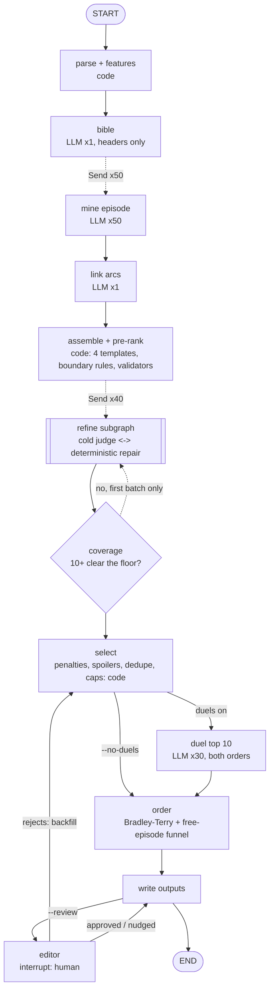

# Promo Finder

Reads a folder of timestamped microdrama screenplays and returns a ranked list of 20–60 s promos:
for each one, the episode and exact `MM:SS.ss` start/end of every segment (in playback order), the
hook, the cliffhanger, one line on why it works, and why it should be posted first.

**Core rule:** LangGraph orchestrates the runtime decisions (fan-out, refine loop, escalation, editor
pause); every stage inside is plain Python. The LLM judges drama but never writes a timestamp: it
cites shot and line IDs, and code converts them to times. The judge that scores promos is fully
cold: it sees only what a stranger scrolling past would see.

## Quick start

```bash
python -m venv .venv
.venv\Scripts\activate            # macOS/Linux: source .venv/bin/activate
pip install -r requirements.txt
copy .env.example .env            # then fill in the keys your config routes need

# the screenplay pack is confidential and not in this repo: put the .txt files in data/show1/
python audit_pack.py --show data/show1          # step 0: check the format before trusting the parser
python run.py --show data/show1 --fast          # ~33 LLM calls, a few minutes on a free tier
python run.py --show data/show1                 # full run, ~140 calls
```

No key yet? `python run.py --show data/show1 --model offline` runs the whole graph with keyword
heuristics instead of an LLM (seconds, no network). It writes to `outputs/<show>-offline/` and is
a pipeline check plus a no-LLM baseline, not the real picks.

## Web app (hosted demo)

**Live:** _add the Render URL here after the first deploy_

`server.py` (FastAPI) runs the same graph behind a small page in `web/`: a settings sidebar plus three tabs.
1. **Upload & Run:** run the sample show, or drop up to 6 episode `.txt` files. Every graph node's progress is shown as it runs.
2. **Editor Review:** the `interrupt()` step as cards (timestamps, hook offset, cliffhanger, open question,
   score bars). Approve, reject with a reason, or nudge a cut, then **Resume graph**: rejected promos are
   backfilled from the reserve and re-ranked.
3. **Quality & Exports:** pass rate, repair yield, calls and cost, `report.md`, and downloads of `ranked.json`,
   `candidates.jsonl`, `run_meta.json` and `decisions.jsonl`.

```bash
pip install -r requirements.txt
uvicorn server:app --port 8000      # http://localhost:8000
```

- **Sample show:** `sample_data/demo_show/` is three invented episodes (`tools/make_sample_show.py`), not
  Kuku's content. `sample_data/llm_cache/` holds the recorded model answers for it, so the sample replays
  in under a second with no API calls.
- **Engines:**
  - *Server models* (`config.cloud.yaml`: Gemini Flash-Lite, Groq gpt-oss-120b fallback).
  - *Your own key* (any LiteLLM model string; the key is used for that run only, kept out of `os.environ`,
    and redacted from logs).
  - *Offline baseline* (no API).
- **Access rules:** uploads on the server's keys need `DEMO_PASSCODE`. Runs that call an API are limited per
  IP per hour.
- **Hosting:** `render.yaml` deploys one free Render web service (Python 3.11). Free instances sleep after
  15 min idle (about 1 min to wake) and lose their disk, so a live run is lost on restart: download the
  results.
- **Full shows:** use the CLI. The hosted demo is capped at 6 episodes per run.

## Run modes

| Command | What it does | LLM calls |
| --- | --- | --- |
| `run.py --show S` | full run, no pause | ~140 |
| `run.py --show S --fast` | 10 hottest episodes (Stage 1 heat), judge 15, 1 repair round, no duels | ~33 |
| `run.py --show S --no-duels` | rank on the rubric score only | ~110 |
| `run.py --show S --max-repair-rounds 0` | ablation: no refine loop | ~120 |
| `run.py --show S --review` | pauses for the editor in the terminal (approve / reject / nudge) | ~140 + backfill |
| `run.py --show S --review --decisions d.json` | same, non-interactive | |
| `run.py --show S --resume` | continue the last run after a crash, quota cap or review pause | the remainder |
| `run.py --show S --model <litellm-model>` | force ONE model for every stage, e.g. an API Kuku provides | |

Call counts are estimates for a 50-episode show. Reruns of the same prompts are served from the
disk cache at zero calls.

### Which model runs which stage (`llm.routes` in `config.yaml`)

| Route | Stages | Models, in fallback order | Why |
| --- | --- | --- | --- |
| `context` | bible, link | `gemini/gemini-4-hydrogen` → `gemini/gemini-3.8-flash` → `groq/openai/gpt-oss-120b` | the two once-per-season calls that shape everything, on the stronger Gemini |
| `mine` | mine | `gemini/gemini-3.8-flash` → `gemini/gemini-flash-lite-latest` → `groq/openai/gpt-oss-120b` | 50 per-episode calls with the bible as context: Gemini, for its large context window |
| `judge` | judge, duel (and the eval checks) | `openai/gpt-6-luna` → `groq/qwen/qwen3.8-27b` → `groq/openai/gpt-oss-120b` | short cold prompts; OpenAI key in `OPEN_API_KEY`; Groq covers caps, outages and refusals |

A daily-quota error moves a route to its next model for the rest of the run. A content-filter refusal
(Azure's default filter can block a slap or a threat; Gemini runs with its safety blocks off for this
fiction) skips to the next model for that one call only. Mining is the slow part on a free Gemini key:
50 calls at 10 requests/minute is about 5 minutes; judging and duels on Azure take about a minute.
Check your Gemini key's real per-day limit in AI Studio: if the daily cap hits, the run stops cleanly
and `--resume` continues it, replaying finished calls from the cache.

## How it works



| Stage | Owner | What it does |
| --- | --- | --- |
| `parse` | code | Screenplay → episodes with stable IDs (`E08.S12` shot, `E08.L07` line) and a contiguous cut grid |
| `features` | code | Stage 1 keyword/emotion/camera tags, per-shot intensity, episode heat, pace score P |
| `bible` | LLM ×1 | From the 50 headers: premise, characters (with appearance-only descriptors), tropes, late-twist spoilers |
| `mine` | LLM ×N | Per episode (+ first 20 s of the next): hooks, cliffhangers, cold-open peaks, a bridge, setups/payoffs, or `no_promo` |
| `link` | LLM ×1 | Links setups and payoffs across the whole season into multi-episode "arc stitch" promos |
| `assemble` | code | 4 templates (continuous, cold open, bridge, arc stitch), tier 1/2 boundary snapping, hard validators |
| `refine` | LLM + code | Cold judge (H, C, A, T + open question) → deterministic repair → re-judge, max 2 rounds, keeps the best |
| `select` / `order` | code | S = 0.30 H + 0.25 C + 0.20 A + 0.15 T + 0.10 P − penalties; IoU dedupe; ≤2 per episode, ≤3 per trope; Bradley-Terry over duels; free-episode funnel boost |
| `duel` | LLM ×30 | "Which would you post?" on the top 10: 3 Swiss rounds, each pair in both orders |
| `editor` | human | Approve, reject with a reason (backfills from the reserve), or nudge a boundary (re-snapped and re-validated) |

**Boundary rules (code).** Tier 1 cuts on shot boundaries and never inside a dialogue line. Tier 2
is a mid-shot trim, used only when tier 1 breaks the 3 s hook rule or the 1.5 s cliffhanger rule:
`start = max(prev_line_end, line_start − 0.2)`, `end = min(next_line_start, line_end + 0.3)`, with a
flash-frame guard (no shot fragment under 0.5 s at a clip edge). Every promo must pass the hard
validators: 20–60 s, 1–4 segments of at least 2 s, hook at ≤3.0 s, end ≤1.5 s after the
cliffhanger, no cut inside a line, every cited ID exists, and a round trip where the published
`MM:SS.ss` strings re-extract exactly the text the judge saw.

**Cold judge.** One promo per call, promo text only. In visual descriptions, character names become
appearance-only descriptors ("the scarred bearded soldier"), because a stranger sees faces, not
names. Names spoken in dialogue stay, since a viewer hears them. Hard gates live in code: a clip
with no open question, or one that answers its own question, can never pass. The bible's spoiler
list is used only by code, in `select`.

**Durability.** A SQLite checkpointer resumes from the last completed step. The LLM adapter's
prompt-hash disk cache replays any call that finished inside an interrupted fan-out, at zero API
cost. Both layers are needed: checkpoints commit per superstep, and a 50-way fan-out is one superstep.

## Outputs (`outputs/<show>/`)

| File | Contents |
| --- | --- |
| `ranked.json` | the deliverable: ranked promos with segments, hook, cliffhanger, why, scores, flags, plus a reserve list |
| `report.md` | human-readable ranking, "post these first", run stats, and auto-generated "where it picks badly" diagnostics |
| `candidates.jsonl` | every judged candidate with the full verdict, penalties and refine history |
| `pool.jsonl`, `rejected_by_code.jsonl` | assembled candidates before judging, and every beat the validators rejected (with reasons) |
| `beats.jsonl`, `bible.json` | raw mining and linking output, story bible |
| `duels.jsonl`, `decisions.jsonl` | every duel game; every editor decision (training data for the weights) |
| `audit.json`, `run_meta.json`, `llm_calls.jsonl` | format audit; models, prompt versions, calls, tokens, cost, time; per-call log |

`parsed.json`, `runs.db` and `.cache/` contain full script text, so they are gitignored along with `data/`.

**Shareable copy: [`raw_outputs/`](raw_outputs/README.md).** `python export_outputs.py` copies every
submitted run byte for byte (final run, ablations, earlier v1 run, offline baseline, editor demo, plus
the run logs and the gold set), leaves out `parsed.json` and `runs.db*`, and checks the result: it fails
if an API key from `.env` appears in any file or if more than 10% of the screenplay is quoted verbatim
(currently 2.9%, all hook and cliffhanger quotes). Re-run it after any new run.

## Checking quality

- `pytest`: parser and boundary rules (including the worked example: Ep 8's beat comes out as
  `00:29.90–00:51.30`), validators, ranking maths, the LLM adapter against a mocked provider (cache,
  corrective retry, daily-quota fallback), and the full graph with an editor review loop on an
  invented 3-episode show. A fuzz test drives the whole graph with a fake provider that returns
  messy but plausible output (bad IDs, every template, every judge failure) and checks that every
  published promo still passes the validators. The tests that need the real pack skip when it is absent.
- `audit_pack.py`: format inventory and parser coverage over every file.
- `evaluate.py --gold eval/gold.json --run outputs/show1`: Precision@10 (IoU ≥ 0.5) against
  promos you hand-label before looking at the output (`eval/gold.template.json`), candidate
  recall, median boundary error, and false positives on episodes you marked as having no promo.
  Pass several `--run` folders for an ablation table. `--rejudge-model` gives cross-model Kendall τ,
  `--stability N` re-judges at temperature 0.8, and `--leak-test N` shows how much a judge that
  *has* read the bible inflates the standalone score.

## What the audit found (50 episodes)

The format is clean: 4 block types, every timestamp well-formed, 100% parser coverage. But camera
shots do **not** tile the timeline as Ep 8 suggests. Across the pack there are 112 gaps between
shots (some with a whole dialogue line inside), 5 overlapping shots, and 9 scenes whose camera
coverage ends early. The parser repairs this into a contiguous grid: gaps of 0.5 s or more become
filler cells, smaller ones are absorbed, and overlaps are trimmed. Every fix is logged. 11% of
lines cross a shot cut, which is why "never cut inside a line" is a hard rule. Episodes run
70–201 s; about 103 minutes in total.

## Assumptions

- Screenplay timestamps match the final video; each episode's clock starts at 00:00.00 and runs
  continuously across scenes (verified on all 50 files).
- Judging the script is a fair proxy for judging footage, since no video is provided.
- The 3 s hook window is measured from the start of the assembled clip.
- A cold open may replay its peak; segments are listed in playback order.
- The 30–45 s sweet spot (soft penalty) and the 10-episode free window are guesses; both are config values.
- Weights and the 3.5 score floor are starting guesses to tune against editor decisions and,
  later, ad metrics (3 s hold rate, CTR, cost per install).

## Known limits

- The judge reads text. It cannot see acting, music or the real pacing of generated footage, and it
  is one model's opinion: use `evaluate.py` before trusting the scores.
- A quiet show can legitimately return fewer than 10 promos. That is by design, not a bug.
- Character names spoken in dialogue still leak context to the cold judge.
- `--model offline` is a keyword baseline: useful to compare against, not to post from.
