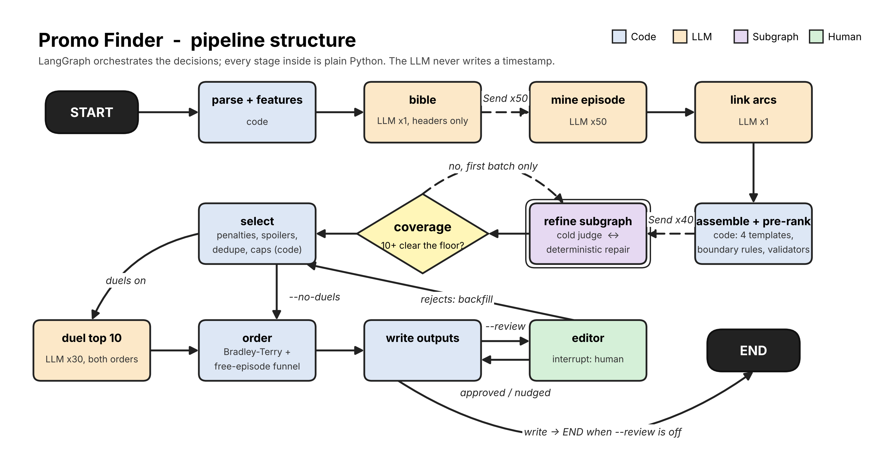
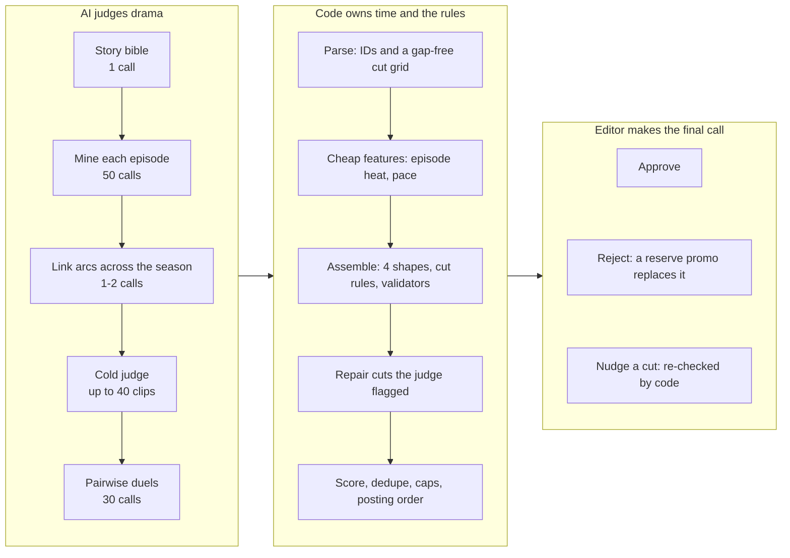
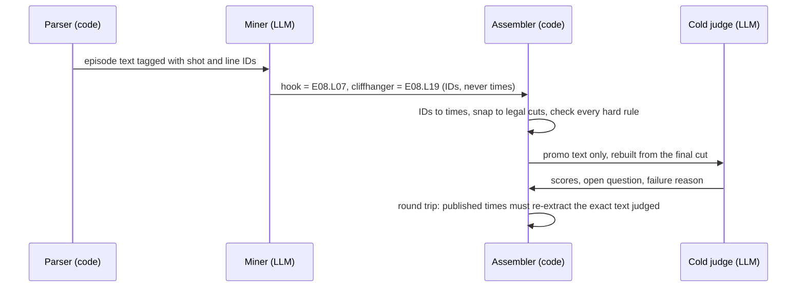
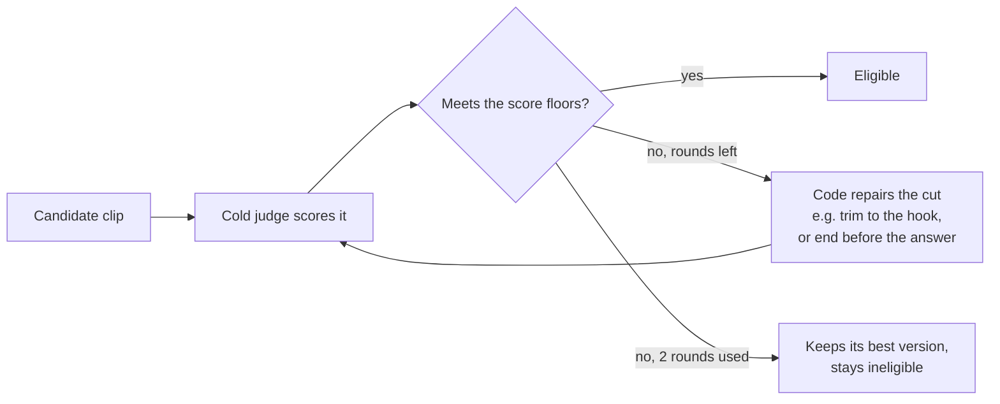
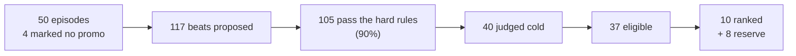
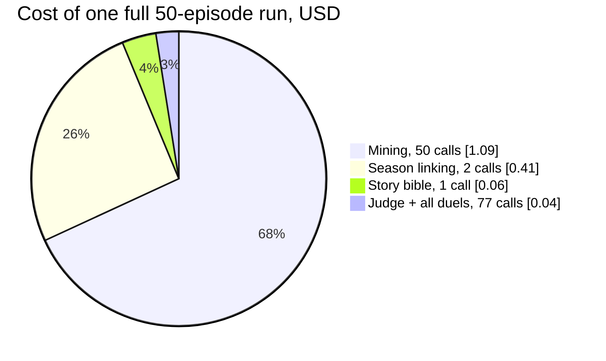
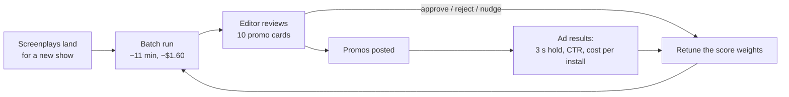
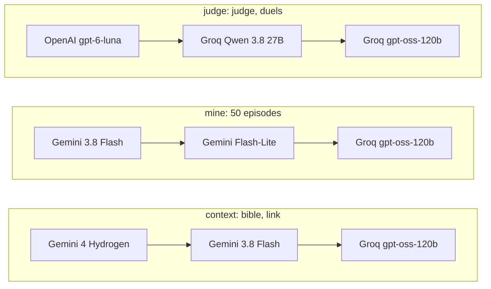

# Promo Finder

**Finds ready-to-post promos in microdrama screenplays, and ranks them.**
Kuku AI Generalist Assignment · Problem 1: Find the Promos

Give it a folder of episode screenplays. It returns a ranked list of 20–60 s promos. Each one has
the episode and exact `MM:SS.ss` start and end of every segment (in playback order), the hook, the
cliffhanger, one line on why it works, and why it should be posted early or late.

**The rule the whole design rests on: the LLM judges drama, code owns time and the rules, and an
editor makes the final call.** The model never writes a timestamp. It points at shot and line IDs,
and code turns those into times and checks every rule in the brief.

### At a glance: the full 50-episode run

| | |
| --- | --- |
| **Input** | 50 episodes, about 103 minutes of screenplay |
| **Output** | 10 ranked promos plus 8 in reserve. Every one passes all the hard rules (length, hook in 3 s, ends on the cliffhanger, no cut inside a line) |
| **Time and cost** | 11 minutes, 130 API calls, about $1.59 (about 3 cents per episode) |
| **Editor's job** | review 10 promo cards instead of watching 50 episodes |
| **Quality** | start and end times match hand-picked promos exactly (median error 0.0 s). Finds 6 of 10 hand-picked promos. The AI judge is not yet calibrated, which is why an editor stays in the loop ([Step 7](#step-7--where-it-picks-badly)) |

**Links:** Hosted demo: _add the Render URL after deploy_ · Raw outputs: [`raw_outputs/`](#raw-outputs) ·
Build plan: [`plan.md`](plan.md)

### Where each question in the brief is answered

| The brief asks | Answered in |
| --- | --- |
| Which problem, and why | [Step 1](#step-1--the-problem-and-why-i-picked-it) |
| Assumptions where the brief was silent | [Step 2](#step-2--assumptions) |
| How it works: what is AI, what is code, where the human stays | [Steps 3](#step-3--read-the-data-before-trusting-it) and [4](#step-4--how-it-works) |
| Each promo: episode, segment timestamps, hook, cliffhanger, why it works | [Step 5](#step-5--results-on-the-full-pack) |
| Rank them: which to post first, and why | [Step 5](#post-these-first-and-why) |
| How you know it's good | [Step 6](#step-6--how-i-know-its-good) |
| Where it picks badly | [Step 7](#step-7--where-it-picks-badly) |
| How it scales to every show, and what it costs | [Step 8](#step-8--scale-and-cost) |
| It runs again on a new show, and the model is easy to swap | [Step 9](#step-9--run-it-yourself) |
| Which AI tools were used, and one place they got it wrong | [Step 10](#step-10--ai-tools-used-and-where-they-got-it-wrong) |

---

## Step 1 · The problem and why I picked it

Today an editor watches every episode of every show to pick promo moments by hand, and a new show
ships every week. That cost grows with every show added.

I picked Problem 1 for three reasons:

- **It is a real, recurring cost,** and the tool replaces the slowest part (watching everything)
  while leaving the judgement call (which promo to post) with a person.
- **The output can be checked.** A promo is an episode plus timestamps, so it can be scored against
  hand-picked promos. "Good drama" is subjective, but "the hook lands in the first 3 seconds" is not.
- **It runs on Kuku's real input,** with timestamps on every line, so the prototype is tested on
  the actual data, not a toy example.

**Scope.** Find and rank promos only: the right moments and the right cut points. No editing,
music or overlays, as the brief says.

## Step 2 · Assumptions

Where the brief was silent, I assumed the following. Every number below is a value in
[`config.yaml`](config.yaml), not hard-coded.

- **Screenplay timestamps match the final video.** Each episode's clock starts at 00:00.00 and runs
  on across scenes (checked on all 50 files).
- **Judging the script stands in for judging footage,** since no video was provided.
- **The 3 s hook window is measured from the start of the assembled clip,** not the episode.
- **A promo has 1 to 4 segments,** from one or more episodes, listed in playback order. A cold
  open may flash the peak first and then replay it in context.
- **"No promo" beats a forced pick.** A quiet episode, or a quiet show, can return fewer promos.
- **Guesses to be tuned later:** a 30–45 s sweet spot (soft penalty only), the first 10 episodes
  being free, the score weights, a 3.5 minimum score, and minimums of 3/5 for hook, cliffhanger and
  standalone. These should be tuned on editor decisions and ad results (3 s hold rate, CTR, cost per
  install), not on 10 hand labels.

## Step 3 · Read the data before trusting it

Before writing the parser, [`audit_pack.py`](audit_pack.py) checked the format of all 50 files.

- **The format is clean:** 4 block types (camera, action, sound, dialogue), every timestamp
  well-formed, and 100% of lines parsed.
- **But the timeline has holes.** The one episode I first read closely (Ep 8) has camera shots that
  cover the timeline end to end. Across all 50, there are **112 gaps between shots** (some with a
  whole line of dialogue inside), **5 overlapping shots**, and **9 scenes** where camera coverage
  ends early. A cutter built on the Ep 8 assumption would slice through dialogue.
- **11% of dialogue lines run across a shot cut.** That makes "never cut inside a line" a hard rule.
- **Some episodes have no good promo.** Ep 8 is quiet and ends on a resolution, so "no promo" has
  to be a valid answer at every stage.
- **The best tension is often short.** Ep 8's tense stretch is about 10 s, half the 20 s minimum,
  so joining moments across cuts and episodes is a core feature.

The parser repairs the timeline into a gap-free grid (gaps of 0.5 s or more become filler cells,
smaller ones are absorbed, overlaps are trimmed) and logs every fix. Episodes run 70–201 s.

## Step 4 · How it works

### 4.1 The pipeline



[LangGraph](https://github.com/langchain-ai/langgraph) runs the order, the per-episode fan-out,
the judge-and-repair loop and the editor pause. Every stage inside is plain Python
([`src/graph.py`](src/graph.py)).

### 4.2 Who does what: AI, code, and the editor



| Stage | Owner | What it does |
| --- | --- | --- |
| Parse + features | code | Screenplay to stable IDs per shot and line (`E08.S12`, `E08.L07`) on a gap-free cut grid. Keyword, emotion and camera tags give each shot an intensity and each episode a "heat" score |
| Bible | LLM × 1 | From the 50 episode headers: premise, characters described by appearance only, the show's tropes, a list of late-season spoilers |
| Mine | LLM × 50 | Per episode (plus the first 20 s of the next): hooks, cliffhangers, peaks, a bridge, setups and payoffs, or "no promo" |
| Link | LLM × 1–2 | Joins setups and payoffs across the whole season into multi-episode promos |
| Assemble | code | Builds clips in 4 shapes, snaps cuts to legal points, and drops anything that breaks a hard rule |
| Judge ⇄ repair | LLM + code | A cold judge scores each clip. Code repairs the cut it flags and re-judges, at most 2 rounds, keeping the best version |
| Select + duel + order | code + LLM × 30 | Score, dedupe and cap. The top 10 face off in pairs. The win record sets the order, adjusted for free episodes and spoilers |
| Editor | human | Approve, reject (a reserve promo takes its place) or nudge a cut (re-checked). Every decision is saved as tuning data |

### 4.3 The timestamp contract

The model is good at reading tension and bad at arithmetic on times, so it is never asked for one.



### 4.4 Promo shapes and cut rules

**Four shapes**, based on how microdrama apps cut their ads:

1. **Continuous:** one stretch, hook to cliffhanger.
2. **Cold open:** a 2–4 s flash of the peak, then the build-up running through it to a new
   unresolved beat. It never ends on the moment it already showed.
3. **Bridge:** the end of one episode and the start of the next, cut before the answer.
4. **Arc stitch:** a setup from one episode joined to its payoff in a later one.

**Hard rules, enforced in code** ([`src/boundaries.py`](src/boundaries.py),
[`src/assemble.py`](src/assemble.py)):

| Rule | Value |
| --- | --- |
| Total length | 20–60 s |
| Segments | 1–4, each at least 2 s |
| Hook | starts within 3.0 s of the clip start |
| Cliffhanger | clip ends within 1.5 s after it |
| Cuts | on shot boundaries, never inside a line of dialogue |
| Mid-shot trim (only when a shot cut breaks the hook or cliffhanger rule) | start 0.2 s before the line, end 0.3 s after it |
| Edges | no sliver of a shot under 0.5 s at either end |
| IDs | every ID the model cites must exist |
| Round trip | the published times must re-extract exactly the text the judge saw |

**Worked example (Ep 8, also a unit test):**

| Version | Cut | Hook lands at | Result |
| --- | --- | --- | --- |
| Shot-boundary cut | 00:28.10 – 00:51.30 | 3.8 s | Rejected: hook later than 3.0 s |
| Mid-shot trim of the start | **00:29.90 – 00:51.30** | 2.0 s | Valid (21.4 s) |
| Tension only | 00:29.90 – 00:39.60 | 2.0 s | Rejected: 9.7 s, under 20 s |

A 1.8 s shift in the start flips the clip from fail to pass. That is why code, not the model,
owns the cut points.

### 4.5 The cold judge and the repair loop

A promo has to work for a stranger scrolling past. So the judge sees **only the promo**: no
story summary, no other episodes, one promo per call. In visual descriptions, character names
become appearance-only descriptions ("the scarred soldier"), because a stranger sees faces, not
names. The bible's spoiler list is used only by code, never shown to the judge.

The judge scores **Hook, Cliffhanger, Standalone and Trope pull** (1–5), writes the open question
a viewer is left with, and says whether the clip answers its own question. Pass or fail is decided
in code, not by the judge: a clip with no open question, or one that answers it, can never pass.



If fewer than 10 clips pass, a second batch of candidates is judged.

### 4.6 Ranking

**Score = 0.30 Hook + 0.25 Cliffhanger + 0.20 Standalone + 0.15 Trope pull + 0.10 Pace − penalties**

- **Pace** is measured by code: how soon the hook lands, lines per second, no dead air over 2 s.
- **Penalties:** each segment beyond 2 (jump cuts), a change of location or time of day across a
  stitch, length outside 30–45 s, and late-season spoilers.
- **Variety:** clips overlapping a better one by more than half are dropped. At most 2 per episode
  and 3 per trope, so the list isn't five cuts of the same scene.
- **Duels:** 1–5 scores bunch together, so the top 10 also go head to head: "which would you
  post?" Three Swiss rounds, each pair asked in both orders to cancel position bias (30 calls). A
  Bradley–Terry fit turns the win record into the final order.
- **Posting order:** a viewer who clicks a promo starts at Episode 1. A hook from Ep 3 pays off in
  minutes; one from Ep 40 makes them wait. Promos inside the free episodes get a boost, and
  spoilers are held back.

### 4.7 The editor stays in the loop

With `--review` (or the web app's review tab), the run pauses after writing its outputs. The
editor approves, rejects with a reason, or nudges a cut. Rejected promos are replaced from the
reserve and the order is re-run. Nudged cuts are re-snapped and re-checked by code. Every decision
goes to `decisions.jsonl`, which is the data for tuning the score weights later.

---

## Step 5 · Results on the full pack

### What happened to every candidate



- Episodes the miner marked "no promo": 6, 8, 17 and 38. Ep 8 is the quiet episode from Step 3,
  so this is the right call.
- Every published promo passes all the hard rules, and every timestamp round trip matches.
- 130 API calls, 0 fallbacks or refusals, 682 s wall-clock.

### The ranked list

Text from the scripts is left out of this public README because the pack is confidential. The
hook, cliffhanger and "why it works" line for each promo are in `raw_outputs/show1/report.md`.

| Rank | Segments (episode, start–end) | Length | Shape | Hook type, lands at | Trope | Score | Duels |
| --- | --- | --- | --- | --- | --- | --- | --- |
| P01 | E31 02:13.00–02:40.00 | 27.0 s | continuous | violence, 0.0 s | humiliation → revenge | 4.60 | 5–1 |
| P02 | E41 01:20.50–01:36.09 → E42 00:00.00–00:21.50 | 37.1 s | bridge | violence, 1.3 s | rescue | 4.25 | 5–1 |
| P03 | E32 01:59.50–02:34.38 | 34.9 s | continuous | threat, 0.1 s | framed for a crime | 4.55 | 3–3 |
| P04 | E16 00:14.30–00:49.80 | 35.5 s | continuous | violence, 0.1 s | rescue | 4.35 | 3–3 |
| P05 | E15 00:46.50–01:26.00 | 39.5 s | continuous | violence, 0.9 s | rescue | 4.20 | 4–2 |
| P06 | E05 00:54.00–01:41.50 | 47.5 s | continuous | humiliation, 0.5 s | humiliation → revenge | 4.30 | 2–4 |
| P07 | E35 02:05.50–02:37.50 | 32.0 s | continuous | shocking line, 0.5 s | betrayal | 4.10 | 3–3 |
| P08 | E12 00:43.70–01:25.00 | 41.3 s | continuous | threat, 0.3 s | evil stepfamily | 4.25 | 2–4 |
| P09 | E33 02:03.50–02:44.80 | 41.3 s | continuous | shocking line, 1.0 s | framed for a crime | 4.10 | 2–4 |
| P10 | E28 02:14.40–02:16.80 → E28 01:37.40–02:18.50 | 43.5 s | cold open | reveal, 0.2 s | hidden identity | 4.10 | 1–5 |

Segments are in playback order, so P10's flash comes before the build-up it is taken from.

### Post these first, and why

1. **P01 and P02:** each won 5 of 6 duels and has a 5/5 hook landing within 1.3 s. P01 is the
   shortest and hardest-hitting clip in the list. P02 is a bridge that cuts across an episode
   break right before the answer.
2. **P03 and P04:** a 5/5 cliffhanger (P03) and a 5/5 hook (P04), both landing in the first
   0.1 s.
3. **P06** is the one to test against them. It is the only shortlisted promo inside the free
   episodes (Ep 5), so a viewer who clicks reaches the moment within minutes. All of the top 5 come
   from Ep 15 or later, which means a 14 to 41 episode wait. Posting P06 next to P01 tells you
   whether that wait costs installs.

### What one promo record looks like (`ranked.json`)

```json
{
  "promo_id": "P01",
  "rank": 1,
  "template": "continuous",
  "segments": [{"episode": 31, "start": "02:13.00", "end": "02:40.00", "shots": ["E31.S36", "E31.S43"]}],
  "duration_s": 27.0,
  "hook": {"type": "violence", "at_s": 0.0, "text": "<the opening beat from the script>"},
  "cliffhanger": {"text": "<the final beat>", "open_question": "<what the viewer is left asking>"},
  "why": "<one line on why it works>",
  "post_reason": "strongest hook in the shortlist (H 5.0) at 0.0s; duels 5-1; outside the free window",
  "scores": {"hook": 5.0, "cliff": 5.0, "standalone": 5.0, "trope": 4.0, "pace": 3.5, "final": 4.6},
  "spoiler": false,
  "round_trip_ok": true,
  "model": "openai/gpt-6-luna",
  "prompt_versions": {"mine": "mine_v3", "judge": "judge_v3"}
}
```

## Step 6 · How I know it's good

Three layers of checks, from cheapest to most telling:

1. **Hard rules, on every promo (code):** the validators and the timestamp round trip from Step 4.
   Nothing reaches the list without passing.
2. **Tests:** 36 `pytest` tests pass. They cover the parser and cut rules (including the Ep 8
   example coming out as `00:29.90–00:51.30`), the validators, the ranking maths, the LLM adapter's
   cache and fallbacks against a mocked provider, the web app, and a fuzz test that feeds the
   whole pipeline messy fake model output and checks every published promo still passes.
3. **A hand-labelled gold set:** 10 promos across 8 episodes (1, 3, 5, 7, 9, 24, 27, 43), fixed
   before scoring. [`evaluate.py`](evaluate.py) measures how many gold promos the tool finds
   (overlap ≥ 50%), how far its cuts are from the gold cuts, and whether the judge passes good clips
   and rejects the rest.

### Three versions, measured on the same pack

| | v1 | v2 | **v3 (final)** |
| --- | --- | --- | --- |
| What changed | first prompts, small judge (gpt-5-nano) | same prompts, stronger judge (gpt-6-luna) | my rewritten, show-agnostic prompts, fixed trope lists, score floors |
| Beats that pass the hard rules | 76% | 83% | **90%** |
| Gold promos found as candidates | 7 / 10 | 6 / 10 | **6 / 10** |
| Median start error vs gold | 3.8 s | 0.0 s | **0.0 s** |
| Judged clips eligible | 34 / 40 | 25 / 40 | **37 / 40** |
| Gold clips the judge passes | 83% | 20% | **80%** |
| Other clips the judge rejects | 0% | 33% | **0%** |
| Spoiler flags raised | – | 12 | **4** |
| Cost per full run (est.) | ~$0.25* | $1.40 | **$1.59** |

\* v1 mined most episodes on the cheaper Flash-Lite after the free Flash quota ran out.

**What this says:**

- **The code side improved steadily:** more valid beats, and start times went from 3.8 s off to exact.
- **Recall is set by mining.** It stayed at 6/10 through two judge and prompt changes: 4 gold promos
  never become candidates, and no judge can rescue them.
- **The judge swings between lenient and strict.** v1 passed nearly everything, v2 rejected good
  clips, v3 passes 80% of gold clips but also everything else. No version yet both keeps the good
  ones and drops the weak ones. That is the main reason the editor step stays.
- **Precision@10 isn't a fair test here,** because only 1 of v3's top 10 falls in a labelled episode.

**The repair loop pays for itself.** With it switched off (same models and prompts), 33 of 40
clips are eligible instead of 37. Seven clips went through repair and 5 of them went from fail to
pass, for 7 extra judge calls (under a cent).

## Step 7 · Where it picks badly

1. **The same story twice in the top 5.** P01 and P03 (Eps 31 and 32) are the same confrontation,
   and P04 and P05 (Eps 15 and 16) are the same fight. Dedupe compares timestamps, and the trope cap
   missed it because the model tagged the same scene with different tropes. Fix: dedupe by story
   beat, not by time range.
2. **The judge's scores aren't calibrated** (Step 6). They should be fitted to editor approvals
   first, then to real ad results.
3. **The judge and the miner disagree about the hook.** The judge calls the hook "too late" on 12
   of 40 clips, even though code guarantees the mined hook lands within 3 s. The line the miner
   picks as the hook isn't always what a viewer would notice first.
4. **The best moments are deep in the season.** All of the top 5 are from Ep 15 or later, so a new
   viewer has a long wait before reaching them. The free-episode boost rarely wins against them.
5. **It reads text, not footage.** It can't judge acting, music, or the real pacing of the
   generated video.
6. **Names leak context.** Names spoken in dialogue tell the "cold" judge who people are, so the
   standalone score is probably a little generous.
7. **The heat heuristic is coarse.** 27% of emotion-tag uses fall outside its word list and get a
   neutral score. This matters for `--fast`, which picks the 10 "hottest" episodes.
8. **The gold set is small and not independent.** 10 promos, drafted with Claude and then
   reviewed by me, with no "no promo" episodes, so the false-positive rate on quiet episodes
   can't be measured yet.

## Step 8 · Scale and cost



- **Per show:** about 11 minutes and $1.59, roughly 3 cents an episode. Costs are estimated from
  token counts at paid-tier list prices. Mining is 68% of the cost, and it's also where recall is
  decided, so that's the last place to cut corners.
- **Every week:** cost grows linearly with episodes. Episodes are mined in parallel (10 at a time),
  so wall-clock time is limited by the provider's rate limits, not the code.
- **Free tiers work:** `--model gemini/gemini-flash-lite-latest` runs every stage on Gemini's free
  Flash-Lite. An earlier version of the hosted demo ran that way, at about $0.02 for 3 episodes.
- **Robust at volume:** each stage group has a fallback chain of models. A daily cap or a
  content-filter refusal moves to the next model. A crash or quota stop resumes with `--resume`, and
  finished calls replay from a disk cache for free. Every output records the model and prompt
  version that produced it.

### How it fits into a weekly release



- **Human time:** the editor goes from watching about 103 minutes of footage per show to reviewing
  10 cards, each with timestamps, scores and the open question.
- **Metrics to track:** editor minutes per show, the share of tool picks the editor approves, and
  ad performance of tool picks against hand picks.
- **With a paid budget:** a panel of stronger judges voting (to fix calibration), and once video is
  available, a multimodal model that checks the real footage.
- **Not done, on purpose:** a local or fine-tuned model (such as a BERT classifier). A run already
  costs under $2, and 10 labels with no negatives is nothing to train on. If confidentiality ever
  requires it, open-weight models can run on-premises by changing one model string.

## Step 9 · Run it yourself

### 9.1 Set up

```bash
python -m venv .venv
.venv\Scripts\activate            # macOS/Linux: source .venv/bin/activate
pip install -r requirements.txt
copy .env.example .env            # macOS/Linux: cp. Then fill in the keys your config routes need
```

### 9.2 Run on a show (including a new one in the interview)

```bash
# put one .txt screenplay per episode in a folder, e.g. data/new_show/
python audit_pack.py --show data/new_show          # check the format before trusting the parser
python run.py --show data/new_show --fast          # 10 hottest episodes, ~33 calls, a few minutes
python run.py --show data/new_show                 # full run, ~130 calls
python run.py --show data/new_show --review        # pause for editor review in the terminal
```

Results go to `outputs/<show>/`. Start with `report.md`; the deliverable is `ranked.json`.

No API key? `python run.py --show data/new_show --model offline` runs the whole pipeline on
keyword heuristics in seconds. It's a pipeline check and a no-LLM baseline, not real picks.

### 9.3 Swap the model

One flag runs every stage on any model [LiteLLM](https://docs.litellm.ai/docs/providers) supports,
for example an API Kuku provides:

```bash
python run.py --show data/new_show --model <provider/model-name>
```

Or set models per stage group in `llm.routes` in [`config.yaml`](config.yaml). Prompts are
versioned files in [`prompts/`](prompts/), and `prompt_version` picks the set.



Each arrow is a fallback. Gemini entries also rotate to a second key before moving on.

### 9.4 Run modes

| Command | What it does | LLM calls (50 episodes) |
| --- | --- | --- |
| `run.py --show S` | full run | ~130 |
| `run.py --show S --fast` | 10 hottest episodes, 15 judged, 1 repair round, no duels | ~33 |
| `run.py --show S --no-duels` | rank on the score alone | ~100 |
| `run.py --show S --max-repair-rounds 0` | ablation: repair loop off | ~120 |
| `run.py --show S --episodes 1-10` | only these episodes | fewer |
| `run.py --show S --review` | editor review in the terminal | + backfill |
| `run.py --show S --review --decisions d.json` | the same, from a file of decisions | + backfill |
| `run.py --show S --resume` | continue after a crash, quota stop or review pause | the rest |

Reruns of the same prompts are served from the disk cache at zero calls.

### 9.5 Web app

[`server.py`](server.py) (FastAPI) runs the same pipeline behind a small page in [`web/`](web/):

1. **Upload & Run:** run the sample show or upload up to 6 episode files, and watch each stage
   progress.
2. **Editor Review:** promos as cards with timestamps, hook timing, cliffhanger, open question and
   score bars. Approve, reject or nudge, then resume.
3. **Quality & Exports:** pass rate, repair yield, calls and cost, the report, and downloads.

```bash
uvicorn server:app --port 8000      # http://localhost:8000
```

- The sample show in [`sample_data/demo_show/`](sample_data/demo_show/) is three invented
  episodes, not Kuku's content. Its recorded model answers let it replay in about a second with no
  API calls.
- Engines: the server's models, your own key for one run (kept out of the environment and the
  logs), or the offline baseline.
- **The server's models are the same as the CLI's:** the same `llm.routes`, prompts, rules and
  scoring. [`config.cloud.yaml`](config.cloud.yaml) only shrinks the run for small uploads (5
  episodes in `--fast`, a top 5 instead of a top 10).
- The server needs `GEMINI_API_KEY`, `OPEN_API_KEY` and `GROQ_API_KEY` (plus an optional second
  Gemini key, `GEMINI_API_KEY_1`). Uploads on the server's keys need a passcode, and API runs are
  rate-limited per IP.
- [`render.yaml`](render.yaml) deploys it as one free Render web service. Full shows go through the
  CLI, since the demo is capped at 6 episodes.

### 9.6 Outputs

| File | Contents |
| --- | --- |
| `ranked.json` | **the deliverable:** ranked promos with segments, hook, cliffhanger, why, scores, flags, and the reserve list |
| `report.md` | the same for people: "post these first", run stats, and "where it picks badly" diagnostics |
| `candidates.jsonl` | every judged clip with its full verdict, penalties and repair history |
| `pool.jsonl`, `rejected_by_code.jsonl` | clips before judging, and every beat the hard rules threw out (with the rule) |
| `beats.jsonl`, `bible.json` | raw mining and linking output, and the story bible |
| `duels.jsonl`, `decisions.jsonl` | every duel, and every editor decision |
| `audit.json`, `run_meta.json`, `llm_calls.jsonl` | format audit; models, prompts, calls, tokens, cost, time; a log of every call |

### Raw outputs

`raw_outputs/` holds unedited copies of every submitted run: the final v3 run, the repair-off
ablation, the earlier v1 and v2 runs, the offline baseline, an editor-review demo, the run logs
and the gold set. It's built by [`export_outputs.py`](export_outputs.py), which fails if any API
key appears in a file or if more than 10% of the screenplay is quoted (currently 3.3%, all hook and
cliffhanger quotes). Because it quotes the confidential scripts, it is shared through the
submission link and not committed to this repo.

## Step 10 · AI tools used, and where they got it wrong

**Tools used:**

- **AI chat assistants** to draft the architecture plan and stress-test it. A review of the first
  draft found six real problems, and all six changed the design ([`plan.md`](plan.md)).
- **Claude Code** to build the pipeline, tests, audit, evaluation, web app and export script, and
  to draft the gold set, which I then reviewed.
- **Me:** the architecture decisions, the v3 prompts, the gold-set review, and every call on what
  to trust.
- **Inside the tool:** Gemini (4 Hydrogen, 3.8 Flash, Flash-Lite), OpenAI (gpt-6-luna; gpt-5-nano
  in v1) and Groq (Qwen 3.8 27B, gpt-oss-120b).

**Where AI got it wrong.** The AI-drafted plan said the camera shots tile the timeline with no gaps,
so code could cut on shot boundaries safely. That was true for Ep 8, the one episode it had looked at.
The audit of all 50 found 112 gaps (some hiding a whole line of dialogue), 5 overlaps and 9 scenes
whose coverage ends early. Cuts built on that assumption would have sliced through dialogue. The
fix: repair the timeline into a gap-free grid, log every repair, and make "never cut inside a line"
a hard rule.

Two smaller ones:

- **The first plan let the "cold" judge see the story bible** to score tropes, which defeats the
  point of a cold judge and inflates the standalone score. The judge is now fully cold.
- **The judge models themselves:** gpt-5-nano passed almost everything, and gpt-6-luna on the same
  prompts rejected 4 of the 5 gold clips it saw. Only the gold set made that visible.

---

## Repo map

```
run.py              CLI: one command, screenplay folder in, ranked promos out
audit_pack.py       format check across every episode file
evaluate.py         gold-set metrics, ablation tables, judge stability and leak tests
export_outputs.py   builds raw_outputs/ and checks it for keys and quoted script
server.py, web/     hosted demo (FastAPI + static page)
config.yaml         every model, weight, threshold and rule (config.cloud.yaml: demo-size overlay)
prompts/            versioned prompts (v1, v3)
src/
  graph.py          LangGraph wiring: fan-outs, refine loop, coverage check, editor pause
  parse.py          IDs and the gap-free cut grid          features.py  heat, intensity, pace
  bible.py, mine.py, link.py                               the three context stages
  assemble.py, boundaries.py                               shapes, cut rules, validators
  judge.py, repair.py, duel.py, rank.py                    cold judge, repairs, duels, ordering
  editor.py, write.py                                      review step and output files
  llm.py            one adapter: routes, fallbacks, key rotation, disk cache, cost tracking
tests/              36 tests, including a fuzzed full-graph run
eval/               gold-set template and labelling guide
docs/pipeline.png   pipeline diagram
```

## Confidentiality

The screenplay pack is Kuku's confidential content. It is not in this repo, and neither is
anything that quotes it: `data/`, `outputs/`, `raw_outputs/`, `eval/gold.json`, the parser output
and the cache are all gitignored. Put the pack's `.txt` files in `data/show1/` to reproduce the runs.
